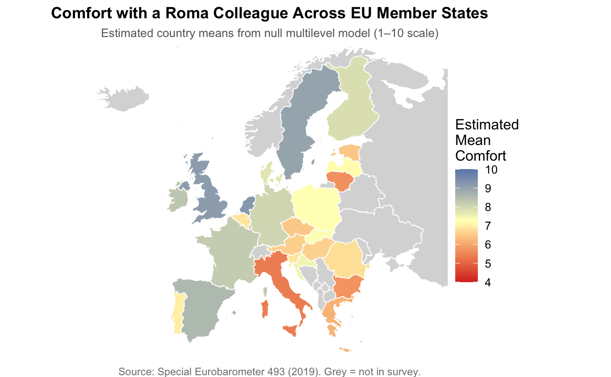
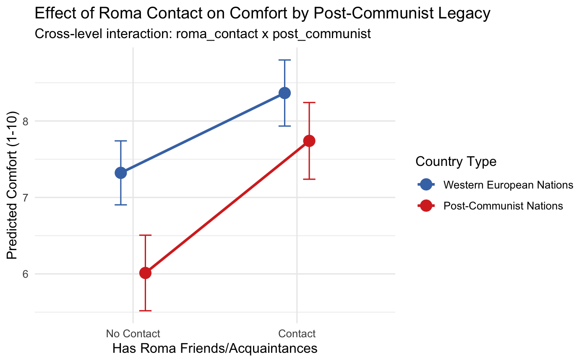

# Attitudes Toward Working With a Roma Colleague Across Europe: A Multilevel Analysis

What explains cross-country variation in how comfortable Europeans would feel working every day with a Roma colleague?

This repository contains the code and country-level data for a multilevel (hierarchical) analysis of Special Eurobarometer 493 (*Discrimination in the European Union*, May 2019). It was a final group project for Survey Methodology II in the MSc in Computational Social Science at Universidad Carlos III de Madrid (UC3M), March 2026.



## The question

The dependent variable is Eurobarometer item **QC12.1**:

> Regardless of whether you are actually working or not, please tell me, using a scale from 1 to 10, how comfortable you would feel if a colleague at work with whom you are in daily contact belonged to each of the following groups? **A Roma person.**
> (1 = not at all comfortable, 10 = totally comfortable)

Respondents are nested in 28 EU member states. Germany is split into East and West, which gives 29 country units.

## Approach

| Stage | Model | Purpose |
|---|---|---|
| 0 | Null model: random intercept for country | Estimate the ICC and justify a multilevel design |
| 1 | + individual predictors: age, gender, education, left–right self-placement, urbanization, economic hardship, having Roma friends | Explain within-country variation |
| 2 | + country predictors: post-communist legacy, GDP per capita, Roma population share, Gini coefficient | Explain between-country variation |
| 3 | + cross-level interaction: Roma contact × post-communist legacy, plus a random-slope test | Check whether the effect of contact depends on country context |

Methods notes:
- Models are fit with `lme4::lmer()` (random intercepts by country).
- About 16% of left–right self-placement is missing. It is filled in by multiple imputation with predictive mean matching (`mice`, m = 10), and results are pooled across the 10 imputations. All other predictors have under 2% missing and use listwise deletion.
- "Indifferent", "it depends" and "don't know" answers to the outcome are excluded rather than imputed. A sensitivity check found that country-level estimates hold up under other codings.
- The models are unweighted. The random intercept accounts for clustering by country.

## Key findings

- **11.5%** of the variance in comfort lies between countries (null-model ICC), well above the usual threshold for multilevel modeling.
- Individual characteristics barely shift that country-level share (ICC 11.2% in Model 1).
- Of the country-level predictors, **post-communist legacy does nearly all the work**. A reduced Model 2 with only that variable lowers the ICC to about 8.1%, with β ≈ −1.16 on the 1–10 scale.
- **Contact matters more where prejudice is higher.** Having Roma friends or acquaintances raises comfort by about 1.05 points in Western European countries and about 1.73 points in post-communist countries. That closes roughly half of the East–West gap.



## Repository structure

```
.
├── analysis/
│   ├── 01_country_indicators.qmd    # builds the country-level indicator table
│   └── 02_multilevel_models.qmd     # EDA, imputation, models 0–3, figures
├── data/
│   ├── raw/                         # public country-level source files (+ where to put ZA7575.dta)
│   └── processed/
│       └── Country_indicators_tb.csv  # output of 01, input to 02
├── figures/                         # selected figures from the analysis
├── Workplace-diversity-hierarchical-model.Rproj
└── README.md
```

## How to reproduce

1. **Get the survey data.** The Eurobarometer microdata can't be redistributed, so it isn't included. Download study **ZA7575** from GESIS (free account required) and save the Stata file as `data/raw/ZA7575.dta`. See `data/raw/PLACE_ZA7575_HERE.md`.
2. **Open the project.** Open `Workplace-diversity-hierarchical-model.Rproj` in RStudio. All file paths use `here::here()`, so they resolve from the project root.
3. **Install the packages:**
   ```r
   install.packages(c(
     "tidyverse", "readxl", "here", "haven", "foreign", "car", "lme4", "lmerTest",
     "ggeffects", "magrittr", "broom", "broom.mixed", "mice", "performance",
     "patchwork", "psych", "sjmisc", "sjPlot", "sf", "rnaturalearth", "rnaturalearthdata"
   ))
   ```
4. **Run in order:**
   - `analysis/01_country_indicators.qmd` (optional, because its output is already in `data/processed/`)
   - `analysis/02_multilevel_models.qmd`

   The imputation uses `set.seed(123)`. With m = 10 and 20 iterations, step 2 can take several minutes.

## Data sources

**Individual-level (not included):**
- European Commission (2019). *Eurobarometer 91.4 (2019)*. GESIS Data Archive, Cologne. ZA7575. https://search.gesis.org/research_data/ZA7575
- European Commission (2019). *Special Eurobarometer 493: Discrimination in the European Union*.

**Country-level (included in `data/raw/`):**

| File | Content | Source |
|---|---|---|
| `GDP_2019_Eurostat.csv` | GDP, current prices (million EUR), 2019 | Eurostat, `nama_10_gdp` |
| `Population_2019_Eurostat.csv` | Population, 1 Jan 2019 | Eurostat |
| `Gini_Eurostat.csv` | Gini coefficient of equivalised disposable income, 2019 | Eurostat, `tessi190` |
| `germany_gdp_per_Capita.csv` | GDP per inhabitant by German *Land*, 2019 (East/West split) | Eurostat, `nama_10r_2gdp` |
| `Population_federated_states.csv` | Population by German *Land* | Destatis, GENESIS table 12411-0010 |
| `Estimates_and_official_numbers_of_Roma_in_Europe updated July 2012.xls` | Estimated Roma population share | Council of Europe, Support Team of the Special Representative of the Secretary General for Roma Issues (updated 2 July 2012) |
| `academic-performance.csv` | PISA reading scores | Our World in Data, based on OECD PISA |

Eurostat data are reused under the [Eurostat copyright notice](https://ec.europa.eu/eurostat/about-us/policies/copyright). Destatis data are under the Data licence Germany – attribution – 2.0. Our World in Data is under CC BY 4.0.

## Authors

Olivia McArthur Blantz, David Valero, Guillermo de Taranco and Noah Fürup. MSc in Computational Social Science, Universidad Carlos III de Madrid.
